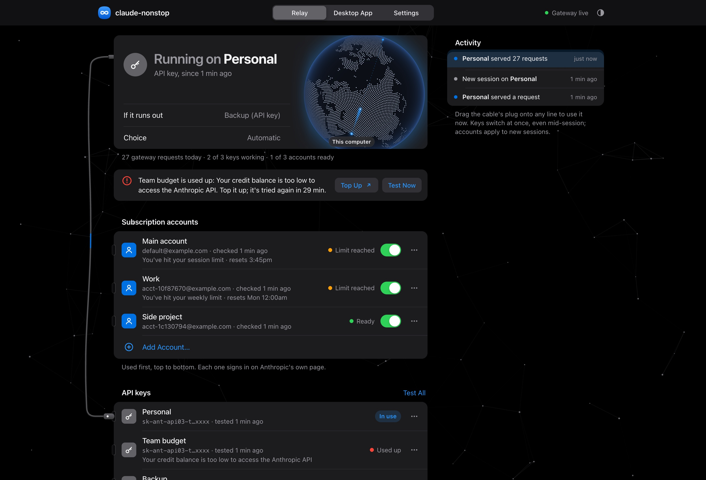

# claude-nonstop

**Keep Claude Code working through plan limits.** When your Claude subscription hits its session or weekly limit, claude-nonstop starts your next session on your next account. When every account is out, it moves to your API keys, one by one. You keep typing `claude` like always.

[](https://github.com/umer-jahangier/claude-nonstop/actions/workflows/ci.yml)
[](https://github.com/umer-jahangier/claude-nonstop/releases/latest)
[](LICENSE)


```
account 1  →  account 2  →  …  →  API key 1  →  API key 2  →  …
```

That's the default order. Mix it however you like (say Work account, then a key, then Main account), and pause any account or key you want kept but not used.

<picture>
  <source media="(prefers-color-scheme: light)" srcset="docs/screenshot-light.jpg">
  
</picture>

## Contents

- [What you get](#what-you-get)
- [Install](#install)
- [Set it up in two minutes](#set-it-up-in-two-minutes)
- [Everyday use](#everyday-use)
- [The web page](#the-web-page)
- [The Claude desktop app](#the-claude-desktop-app)
- [Commands](#commands)
- [How it works](#how-it-works)
- [Security and privacy](#security-and-privacy)
- [What setup changes on your computer](#what-setup-changes-on-your-computer)
- [Updating](#updating)
- [Troubleshooting](#troubleshooting)
- [Uninstall](#uninstall)
- [FAQ](#faq)
- [Advanced options](#advanced-options)
- [Development](#development)

## What you get

- **Subscriptions first.** Every session starts on the first account that still has usage left. API keys are only used once every account is out.
- **Never stalls at a limit.** If an account runs out in the middle of your work, the same conversation reopens on your next account, then on your API keys, and carries on by itself. With nothing else left, it waits for the reset and continues on its own.
- **Keys switch mid-request.** A local gateway sends each request with your first working key. If a key runs out of credit, the same request goes out again on the next key, and your session never notices.
- **Your chats stay.** Every account and key shares one Claude Code history, so it's always the same conversation, and `claude --resume` shows all of them. In the desktop app, your claude.ai chats and earlier sessions can be brought into third-party mode with one import.
- **One command to install, nothing to configure by hand.** It brings its own Node.js, installs Claude Code if you don't have it, and sets everything up.
- **A web page at `https://claude.nonstop`** to add accounts and keys, see what's in use, and switch lines by dragging a cable. Dark by default, with Light and Automatic (your computer's setting) one click away.
- **Works in the terminal and in the Claude desktop app**, on macOS, Windows and Linux.
- **Your secrets stay on your computer, encrypted.** Keys are only ever sent to Anthropic.
- **Updates itself** from GitHub releases.

## Install

Open a terminal and paste one command. You don't need to install anything first.

**macOS and Linux**

```bash
curl -fsSL https://raw.githubusercontent.com/umer-jahangier/claude-nonstop/main/install.sh | sh
```

**Windows** (in PowerShell)

```powershell
irm https://raw.githubusercontent.com/umer-jahangier/claude-nonstop/main/install.ps1 | iex
```

The installer takes about a minute. It:

1. installs claude-nonstop and its own copy of Node.js into `~/.claude-nonstop` (`%USERPROFILE%\.claude-nonstop` on Windows), and installs Claude Code too, or updates it if it's older than 2.1.234;
2. gives the web page its short address, `https://claude.nonstop`, with a certificate your computer trusts;
3. sets up the Claude desktop app to run on your API keys, if you have it;
4. starts the local gateway now, and every time you log in;
5. makes plain `claude` go through claude-nonstop;
6. opens the web page.

### What you'll be asked

Steps 2 and 3 change things outside your home folder, so your computer asks first. All of it is optional: decline anything and the rest still works.

| | macOS | Windows | Linux |
| --- | --- | --- | --- |
| Short address `claude.nonstop` | Your password, once | One "Allow changes?" confirmation | Your password (sudo), once |
| Trusted certificate (no "Not secure") | Your password again, to trust it | One "Install this certificate?" confirmation | Nothing to approve (needs `certutil`, see [Troubleshooting](#troubleshooting)) |
| Claude desktop app | System Settings opens with a profile: double-click it, click **Install** ([why it says "author unknown"](#why-does-macos-say-the-profiles-author-is-unknown)) | Included in the confirmation above | Included in the password prompt above |

Say no to the short address and the page lives at `http://claude-nonstop.localhost` instead, which works on every computer with no setup at all.

> **Open a new terminal window after installing**, so plain `claude` goes through claude-nonstop.

## Set it up in two minutes

1. **Open the web page.** The installer opens it for you. Later, run `claude-nonstop ui` (it signs you in with a one-time link, so only you can use the page), or go to `https://claude.nonstop`.
2. **Add your accounts.** Your normal Claude Code login is already there as **Main account**. For each extra Claude subscription, click **Add Account…**, give it a name, and sign in on Anthropic's page that opens in your browser. As soon as you're signed in, the page checks whether the account has usage left.
3. **Add your API keys.** Click **Add API Key…** and paste a key from [platform.claude.com/settings/keys](https://platform.claude.com/settings/keys). Each key is tested as soon as you save it.

You never need to press Check. The gateway checks every account and key when it starts, and the page checks again whenever you open it or switch back to it. Anything with a clear answer from the last 5 minutes is skipped. While a check runs, its row shows **Checking…**.

That's it. From now on, just run `claude`:

```
$ claude
claude-nonstop: checking Main account...
claude-nonstop: Main account: You've hit your session limit · resets 3:45pm
claude-nonstop: checking Work...
claude-nonstop: using Work (subscription)
```

## Everyday use

- **Just type `claude`.** claude-nonstop picks the first account with usage left, or your first working key when every account is out. Everything else about Claude Code stays the same.
- **Hit a limit in the middle of your work?** Nothing to do. claude-nonstop reopens the same conversation on your next account (or your API keys) and tells Claude to continue where it left off. You'll see Claude Code restart for a moment, then the work carries on.
- **Only one account, or everything is out?** Claude Code waits in the open session and continues the task by itself when your limit resets (shown as *Continuing automatically at 3:45pm*). On API keys, claude-nonstop does the waiting and continues as soon as an account or a key has usage again. Leave the terminal open.
- **Running on API keys?** When a key runs out, the next key takes over on the very same request.
- **Want a particular line right now?** On the web page, drag the cable's plug onto it, or choose **Use This Account** / **Use This Key** in its **…** menu. A key switches at once, even mid-session; an account applies to your next session. Click **Use Automatic** to hand control back.
- **Force a mode for one session:** `claude-nonstop --api` uses only API keys, `claude-nonstop --sub` only subscription accounts.
- **Keep an eye on it.** The page's **Activity** list shows every request, switch and new session as it happens, and its tab icon turns red when every API key is used up.

## The web page

| Part | What it does |
| --- | --- |
| Status card | The line in use (or the one your next session starts on), what takes over if it runs out, and whether you're on **Automatic** |
| Alerts | Anything that needs you: an account that isn't signed in, a used-up key (with a **Top Up** link), no keys yet |
| Accounts and API keys | One list, tried top to bottom. Drag a line by its **≡** handle (or focus it and press ↑/↓) to mix accounts and keys in any order. Each line has a switch to pause it and a **…** menu: Use This Account/Key, Check Usage or Test Key, Sign In Again, Rename, Pause/Resume, Move Up/Down, Remove. **Test All Keys** tests every key |
| The cable | Plugged into the line in use. Drag its plug onto another line to switch to it; the plug's light blinks for every request |
| Globe | A light travels from your computer to Anthropic and back for every gateway request. Drag it to spin it |
| Activity | Every request, key switch and new session, live |
| Desktop App tab | Sets up the Claude desktop app with one click, with manual steps as a fallback |
| Settings tab | Appearance (Dark by default, Light, or Automatic to follow your computer), how long a used-up key or a limited account is skipped, and what's set up on this computer |

**Addresses.** Any of these opens the page:

| Address | When |
| --- | --- |
| `https://claude.nonstop` (or `https://claude-nonstop`) | After setup added the short address. `http://` sends you to `https://` |
| `http://claude-nonstop.localhost` | Always works, no setup needed |
| `http://claude-nonstop.localhost:43117` | Always works too, even if something else on your computer already uses port 80 or 443 |

## The Claude desktop app

The desktop app can run on your subscription accounts and API keys through claude-nonstop, switching between them as lines run out, while a plain Claude.ai sign-in stays one click away on its sign-in screen.

The installer sets it up for you using the settings locations Anthropic documents for the app ([configuration reference](https://claude.com/docs/third-party/claude-desktop/configuration-format)):

- **Windows:** registry policy under `HKLM\SOFTWARE\Policies\Claude`, in the installer's one confirmation.
- **Linux:** `/etc/claude-desktop/managed-settings.json`, in the installer's one password prompt.
- **macOS:** a configuration profile. macOS only lets you approve profiles yourself, so System Settings opens with it: double-click **claude-nonstop for the Claude desktop app**, then click **Install**. (If you closed it, it's under **System Settings → General → Device Management**.) macOS will say *"The author of this profile is unknown"*: that's expected, and [here's why](#why-does-macos-say-the-profiles-author-is-unknown).

Then **quit and reopen the desktop app.** Its sign-in screen offers the third-party option, which runs on your API keys through claude-nonstop, and **Claude.ai** for your subscription. Pick the third-party option when your subscription is out.

**In third-party mode the desktop app walks your order too.** Each request goes out on the first subscription account with usage left, on that account's own Claude Code sign-in; when an account hits its limit, the same request goes out again on the next line, and when every account is out, on your API keys. The cable, **Use This Account** and your order apply to the desktop app just as to the terminal. The page's **Desktop app** line shows the account or key it's on.

**Usage left.** Each account's line shows how much of its plan is used: the session (its 5-hour window) and the week, with when each resets, read from the same place Claude Code's `/usage` reads, with that account's own sign-in. It refreshes every 5 minutes while the gateway runs, with every account check, and when the page opens; `claude-nonstop status` shows it too. API keys have no such readout: Anthropic shows a key's credit only in the [Console](https://platform.claude.com/settings/billing), so a key's line shows its last test instead.

**Switch alerts.** claude-nonstop watches the account your desktop app signs in to (pick it on the page's **Settings → Claude desktop app**; the Main account by default). While the app is open it checks that account at most every 10 minutes, and when the advice changes it tells you on the page and with a notification: *"SXL-Acc reached its limit: switch the desktop app to the third-party option"*, then later *"SXL-Acc has usage again: switch back to Claude.ai to stop spending API credit"*. If no key can take over either, it says so instead. The switch itself is yours to make on the app's sign-in screen. Turn the alerts off with **Switch alerts**.

**API keys are used as plain API.** Every request the gateway sends on a key goes out as an ordinary API request, with no Claude Code identity in its headers or its system prompt, so it's billed as plain API use: credit that lists only *API* under **Applies to** (promotional credit, say) works. Subscription accounts are different: Anthropic takes only Claude Code's own requests on a sign-in, so those go out as Claude Code.

**Your chats come along.** Third-party mode keeps its own history, separate from claude.ai. claude-nonstop turns on Anthropic's [import](https://claude.com/docs/third-party/claude-desktop/import): in the desktop app, open **Settings → Import & export → Import…** to bring over your claude.ai chats and projects and the Code and Cowork sessions already on this computer. A new chat also offers the import when it finds earlier sessions. It's a copy: your claude.ai history stays where it is, and running it again adds only what's new.

**Browser, extensions, plugins and connectors work as before.** Third-party mode turns some of these off unless they're switched on, so claude-nonstop switches them on: the built-in browser in Code sessions (with its address bar, not just the localhost preview), desktop extensions, and Anthropic's plugin marketplace in Claude Code. The app also hides its connector directory and its Add button in third-party mode, so claude-nonstop brings the directory back as a plugin marketplace: open **Directory → Organization → nonstop-connectors** in the desktop app to browse the 480 connectors from [Anthropic's connector directory](https://claude.com/connectors) that work in third-party mode (Canva, Notion, Figma, Linear, Atlassian, Miro and more), install the ones you want, and sign in to each when you first use it. The list lives in this repository's [`connectors`](connectors) folder and the app fetches updates by itself. For a server that isn't in the directory, add it on the page's **Desktop App** tab or with `claude-nonstop connectors add <name> <https-url>`; on a Mac, each change to that list means approving the updated profile in System Settings. Connectors made by Anthropic itself (such as Gmail, Google Drive or Microsoft 365) only work on the Claude.ai sign-in.

Installed the desktop app later? Run `claude-nonstop desktop`, or click **Set Up Automatically** on the page's **Desktop App** tab.

## Commands

| Command | What it does |
| --- | --- |
| `claude` | Claude Code through claude-nonstop (after setup) |
| `claude-nonstop [claude args]` | The same, without the shortcut |
| `claude-nonstop --api [args]` | Use API keys only |
| `claude-nonstop --sub [args]` | Use subscription accounts only |
| `claude-nonstop ui` | Open the web page |
| `claude-nonstop status` | What's set up, what's in use, and your order |
| `claude-nonstop move <n> up\|down` | Move account or key n (its number in `status`) one place |
| `claude-nonstop pause <n>` / `resume <n>` | Stop using account or key n without removing it, or use it again |
| `claude-nonstop keys` | Test every API key |
| `claude-nonstop keys add [name]` | Save a key (typed hidden, or piped on stdin) |
| `claude-nonstop keys remove <n>` | Remove key number n |
| `claude-nonstop accounts` | List accounts and who each one is signed in as |
| `claude-nonstop accounts add [name]` | Add an account and sign in to it |
| `claude-nonstop accounts login <n>` | Sign in to account n again |
| `claude-nonstop accounts check` | Check which accounts have usage left |
| `claude-nonstop accounts on <n>` / `off <n>` | Turn account n on or off |
| `claude-nonstop accounts remove <n>` | Sign out of account n and remove it |
| `claude-nonstop desktop` | Set up the Claude desktop app |
| `claude-nonstop connectors` | List the connectors the desktop app shows when it runs on your API keys |
| `claude-nonstop connectors add <name> <https-url>` | Add a connector (signs in with OAuth; `--no-oauth` for servers without sign-in) |
| `claude-nonstop connectors remove <name>` | Remove a connector |
| `claude-nonstop setup` | Run the whole setup again (safe to repeat) |
| `claude-nonstop service install` / `uninstall` | Start the gateway at login, or stop doing so |
| `claude-nonstop shell install` / `uninstall` | Make plain `claude` go through claude-nonstop, or undo it |
| `claude-nonstop update` | Install the newest version now |
| `claude-nonstop uninstall [--purge]` | Remove claude-nonstop (`--purge` also deletes your saved keys and accounts) |

Claude Code's own subcommands (`claude mcp`, `claude doctor`, `claude update`, `claude --version`, …) pass straight through.

## How it works

**Your order.** Accounts and keys sit in one list that you arrange, for example Work account, then a key, then Main account. A session starts on the first line with usage left and moves down the list as lines run out. A paused line keeps its place and its sign-in or key, but is skipped until you resume it. Keys next to each other in the list work as a team: when one runs out, the gateway sends the request again on the next one, mid-request. When the whole team is out, the session moves on to the line after it.

**Choosing an account.** Before a session starts, claude-nonstop asks each account, in order, whether it has usage left. Each check is one tiny Haiku request run by Claude Code itself. An account that hit its limit is skipped for 10 minutes before it's asked again (change this in **Settings**).

**Extra accounts.** Each extra account is its own Claude Code configuration folder (`CLAUDE_CONFIG_DIR`, the [documented way](https://code.claude.com/docs/en/authentication#log-in-with-multiple-accounts) to stay signed in to several accounts). You sign in on Anthropic's own page, and Claude Code stores the login in its own credential store; claude-nonstop never sees or stores subscription credentials. Your history, settings, plugins, skills and MCP servers are shared by every account, so they all feel the same and `claude -c` works across them.

**Mid-session.** claude-nonstop starts Claude Code with a few background hooks ([`StopFailure`](https://code.claude.com/docs/en/hooks#stopfailure) and friends, documented Claude Code features). When a turn stops on a usage limit or a used-up key, the hook tells claude-nonstop, which checks the next lines in your relay. If one has usage, it reopens the same conversation there with `claude --resume <session> "Continue where you left off."`, keeping the flags you started with. If nothing has usage, it leaves the session alone: on a claude.ai account, Claude Code's own [automatic continue](https://code.claude.com/docs/en/interactive-mode.md#wait-for-a-usage-limit-to-reset) picks the task up at the reset; on API keys, claude-nonstop checks again every few minutes and reopens the conversation when something frees up. Your own hooks and `--settings` keep working alongside.

**Back to your subscription.** In Automatic mode, a session that ended up on API keys doesn't stay there: every 5 minutes claude-nonstop asks the accounts above the keys in your order whether they have usage again, and when one does, the conversation moves back to it as soon as Claude finishes its current turn (`claude --resume <session>`, with nothing typed for you). When you've plugged the cable into a line yourself, sessions stay on it.

**API keys.** Claude Code talks to the gateway at `http://127.0.0.1:43117`, which forwards each request to Anthropic with your first working key. A key that answers *credit balance too low*, *spend limit reached*, *invalid* or *not allowed* is marked used up, the same request is sent again on the next key, and the used-up key is skipped for 30 minutes before it's tried again, in case you topped it up. If the gateway isn't running, claude-nonstop hands Claude Code a key helper instead, which picks a key again every two minutes.

**Rate limits (429) and outages (5xx)** stay on the current key: keys in one organization share one rate limit, and Claude Code already retries these. If your keys belong to separate organizations and you'd like rate-limited keys skipped too, change one line in [`src/classify.js`](src/classify.js).

## Security and privacy

- **Everything runs on your computer.** The gateway and the web page accept connections from this computer only, and answer only to their own names.
- **API keys are encrypted at rest** (AES-256-GCM). The encryption key is held by the macOS Keychain, Windows DPAPI or the Linux Secret Service; headless Linux machines without one fall back to a file only you can read, and the page tells you when that's the case.
- **Keys are only sent to `api.anthropic.com`.** After you save a key, only a masked form is ever shown again.
- **The web page needs a one-time link** from `claude-nonstop ui`, which becomes an HttpOnly, SameSite=Strict cookie. Every request also carries a header other websites can't send, so pages you visit can't reach it.
- **The gateway has its own random token**, so other programs on your computer can't spend your keys.
- **HTTPS uses a certificate made on your computer.** The certificate authority that signs it is used once, for this computer's own names, and its private key is thrown away immediately: it's never saved, so it can never sign anything else. Uninstalling removes it from your trusted certificates.
- **The globe's "This computer" spot is guessed from your timezone** inside the page. It's never sent anywhere.
- **No telemetry.** The only outside connections claude-nonstop makes are to Anthropic (your requests and the account checks) and to GitHub (to check for updates).

## What setup changes on your computer

Nothing is hidden. Here's everything, and how each part is undone:

| What | Where | Undone by |
| --- | --- | --- |
| The app, its Node.js, your encrypted keys and settings | `~/.claude-nonstop` | `claude-nonstop uninstall --purge` |
| The `claude` shortcut | A marked block in your zsh, bash and fish startup files; on Windows, a `claude.cmd` placed first on your user PATH | `claude-nonstop shell uninstall` |
| Start at login | macOS LaunchAgent `dev.claude-nonstop.gateway`; Linux systemd user service `claude-nonstop` (or an autostart entry); Windows `HKCU\…\Run` entry | `claude-nonstop service uninstall` |
| Short address | A marked block in your hosts file (`/etc/hosts`, or `C:\Windows\System32\drivers\etc\hosts`) | `claude-nonstop uninstall` |
| Trusted certificate | macOS login keychain; Windows current-user root store; Linux browser certificate stores | `claude-nonstop uninstall` |
| Desktop app settings | macOS profile; Windows `HKLM\SOFTWARE\Policies\Claude`; Linux `/etc/claude-desktop/managed-settings.json` | `claude-nonstop uninstall` (macOS: remove the profile in System Settings → General → Device Management) |
| Linux only: permission to use ports 80 and 443 | Given to claude-nonstop's own Node.js, never a system-wide one | Removed with `~/.claude-nonstop` |

## Updating

claude-nonstop checks GitHub for a new release every hour (and a minute after it starts) and installs it by itself, so you rarely need to do anything. To update right now:

```bash
claude-nonstop update
```

Running the install command again also updates. It skips everything that's still set up, so it normally asks nothing.

## Troubleshooting

Start with `claude-nonstop status`: it shows what's set up, what's in use and how each account and key last checked out.

- **Plain `claude` doesn't go through claude-nonstop.** Open a new terminal window. If it still doesn't, run `claude-nonstop shell install` and open another one.
- **The page doesn't open.** Make sure the gateway runs: `claude-nonstop service install` starts it now and at every login. Then run `claude-nonstop ui`. `http://claude-nonstop.localhost` always works as a fallback.
- **`claude.nonstop` isn't found, or shows "Not secure".** Run `claude-nonstop setup` again and allow the prompts. Typing it into the address bar for the first time? Include `https://`, so the browser doesn't search for it.
- **Linux: the certificate wasn't trusted.** Browsers there read certificates through NSS. Install its tools (`sudo apt install libnss3-tools` on Debian and Ubuntu, `sudo dnf install nss-tools` on Fedora), then run `claude-nonstop setup` again.
- **A session didn't continue by itself after a limit.** Check `claude-nonstop status`: the **Claude Code** line should show 2.1.234 or newer (run `claude update` if not). Keep the terminal open while it waits, and start sessions with `claude` (or `claude-nonstop`) so claude-nonstop can look after them.
- **An account says "Not signed in".** Click **Sign In…** in its alert, or run `claude-nonstop accounts login <n>`.
- **Every key shows "Used up".** Top one up at [platform.claude.com/settings/billing](https://platform.claude.com/settings/billing), then click **Test Now** on it, or **Forget All Cooldowns** in **Settings**.
- **The desktop app doesn't offer the third-party option.** Quit it completely and reopen it. On macOS, check the profile is installed under **System Settings → General → Device Management**. Then run `claude-nonstop status`: the **Desktop app** line should say it's set up.
- **The desktop app says "Gateway was unreachable".** The gateway isn't running: run `claude-nonstop service install`.
- **Something else uses port 80 or 443.** claude-nonstop leaves it alone and serves the page on port 43117 instead; `claude-nonstop ui` opens the right address, and `http://claude-nonstop.localhost:43117` always works.
- **Logs.** `~/.claude-nonstop/claude-nonstop.log` (which line was chosen, key switches) and `~/.claude-nonstop/gateway.log`.

## Uninstall

```bash
claude-nonstop uninstall          # keeps your saved keys and accounts
claude-nonstop uninstall --purge  # also deletes them
```

This stops the gateway, removes the `claude` shortcut, the short address, the trusted certificate and the desktop app settings (on macOS, remove the profile in **System Settings → General → Device Management**), and tells you about anything it couldn't undo. Installed with npm? Finish with `npm uninstall -g claude-nonstop`.

## FAQ

### Is this allowed?

claude-nonstop runs the unmodified Claude Code and uses only documented features. Every account and key you add must be your own: each teammate installs claude-nonstop and adds their own. Sharing a subscription account between people is against Anthropic's terms.

### Why does it ask for my password?

Only for the short address, the trusted certificate and the desktop app settings, which live outside your home folder. Decline and everything else still works, at `http://claude-nonstop.localhost`.

### Why does macOS say the profile's author is unknown?

When you install the desktop app profile, macOS shows *"The author of this profile is unknown. Make sure you trust the sender before installing."* It says this about **every profile that isn't digitally signed**, whatever is inside.

The claude-nonstop profile isn't signed because it's made on your own Mac during setup: it holds your computer's private gateway key, so no one could sign it in advance. It's safe to install, and you can check exactly what it does before you click **Install**:

- **What it contains:** six settings for the Claude desktop app. Its third-party provider is set to *gateway*, the gateway address is `http://127.0.0.1:43117` (this computer), the gateway key is your local claude-nonstop token, the auth scheme is *bearer*, the import of your earlier chats is turned on, and Code sessions may reach any site (`coworkEgressAllowedHosts` set to `["*"]`, so the app doesn't force strict sandbox mode). Turn **Strict sandbox** on in the web page's **Settings** to keep that restriction instead. In System Settings, click the profile, then **Settings** to see them.
- **What it doesn't do:** it installs no certificates, changes no system settings, and touches no other app.
- **Undoing it:** remove it any time in **System Settings → General → Device Management**. The file is also saved at `~/.claude-nonstop/claude-nonstop-desktop.mobileconfig` if you'd like to read it.

Rather not install a profile at all? Set the desktop app up by hand with the values on the page's **Desktop App** tab.

### Will I still see limit messages?

Only when every account and key is out. When one line runs out, Claude Code may show its limit notice for a second or two while the conversation reopens on the next line; then it carries on. When everything is out, you'll see Claude Code's own *Continuing automatically at …* line while it waits for the reset.

### Do I need API keys?

No. With only subscription accounts, claude-nonstop moves from one to the next. Keys are the fallback for when every account is out.

### Does it change how Claude Code behaves?

No. It picks which account or key a session uses, then runs Claude Code as usual.

### Can my teammates use it?

Yes. Send them this page; each of them installs it and adds their own accounts and keys.

## Advanced options

**Installer environment variables:**

| Variable | Effect |
| --- | --- |
| `CLAUDE_NONSTOP_SKIP_CLAUDE=1` | Don't install Claude Code |
| `CLAUDE_NONSTOP_REF=<tag or commit>` | Install a specific version instead of the latest release |
| `CLAUDE_NONSTOP_SETUP_ARGS="…"` | Flags to pass to `claude-nonstop setup` (see below) |
| `CLAUDE_NONSTOP_BIN_DIR=<dir>` | macOS and Linux: where to put the `claude-nonstop` command (default `~/.local/bin`) |

For example, to install without the shortcut and without opening the page:

```bash
curl -fsSL https://raw.githubusercontent.com/umer-jahangier/claude-nonstop/main/install.sh | CLAUDE_NONSTOP_SETUP_ARGS="--yes --no-shell --no-open" sh
```

**`claude-nonstop setup` flags:**

| Flag | Effect |
| --- | --- |
| `--yes` | Don't ask questions |
| `--no-open` | Don't open the web page at the end |
| `--no-service` | Don't start the gateway at login |
| `--no-shell` | Don't make plain `claude` go through claude-nonstop |
| `--no-hosts` | Skip the short address (and with it, HTTPS) |
| `--no-desktop` | Don't set up the Claude desktop app |
| `--no-system` | Skip everything that needs administrator rights |

**Other environment variables:** `CLAUDE_NONSTOP_HOME` moves the data folder (default `~/.claude-nonstop`); `CLAUDE_NONSTOP_PORT` changes the gateway port (default `43117`).

**Prefer npm?** `npm install -g github:umer-jahangier/claude-nonstop`, then run `claude-nonstop setup`. (This needs Node.js 18 or newer, and doesn't update itself: update with npm.)

## Development

```bash
git clone https://github.com/umer-jahangier/claude-nonstop
cd claude-nonstop
npm test
```

No dependencies. Tests run against a fake Claude API and a fake `claude` binary, and CI runs them on macOS, Windows and Linux with Node 18, 20 and 22, plus the installers end to end. The web page is a single file, [`src/ui/index.html`](src/ui/index.html); its design system is in [`DESIGN.md`](DESIGN.md).

The connector marketplace is generated. To refresh it from claude.com/connectors (each server is checked for how it signs in), run `node scripts/build-directory.js && node scripts/build-marketplace.js`, then `claude plugin validate connectors`.

---

claude-nonstop is an independent project and isn't affiliated with or endorsed by Anthropic. Claude and Claude Code are trademarks of Anthropic. MIT licensed.
